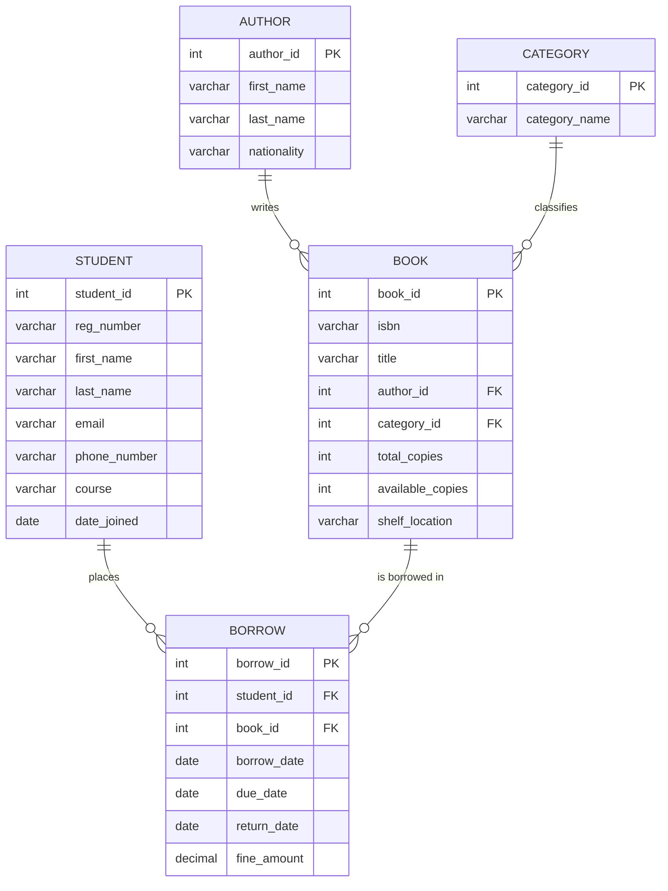

# College Library Management System - Database Design

A relational database design and SQL implementation for a college library, modeling students, books, authors, categories, and the borrowing process. Built as part of my Data Science and Analytics diploma coursework and extended here as a portfolio-ready project.

## Problem

Colleges need a way to track which books exist, who borrows them, when they're due back, and how fines are calculated for late returns - while keeping data consistent and avoiding duplication (e.g., an author's details shouldn't be repeated for every book they've written).

## Entity Relationship Diagram

Entities: **STUDENT**, **BOOK**, **AUTHOR**, **CATEGORY**, and **BORROW** (an associative entity resolving the many-to-many relationship between students and books).



## Design Decisions

- **STUDENT–BOOK is many-to-many** (a student borrows many books over time; a book is borrowed by many students over time). This is resolved with the **BORROW** associative entity, which also carries its own attributes (dates, fine) - a textbook case for why a junction table is needed instead of a direct many-to-many link.
- **AUTHOR and CATEGORY are separated out** rather than stored as plain text columns on BOOK. This avoids repeating an author's full details on every book row (violates 1NF/2NF spirit) and makes it possible to query "all books by this author" cleanly.
- **`available_copies` vs `total_copies`** on BOOK tracks real-time inventory without needing to COUNT active borrows every time - a common trade-off between normalization purity and query performance.
- **Constraints**: `CHECK (due_date >= borrow_date)` and `CHECK (available_copies <= total_copies)` enforce business rules at the database level, not just in application code.

## Files

| File | Purpose |
|---|---|
| `sql/schema.sql` | Table definitions, primary/foreign keys, constraints, indexes |
| `sql/sample_data.sql` | Sample rows for testing (students, books, borrow records) |
| `sql/queries.sql` | 8 analytical queries: overdue books, popularity ranking, fines owed, inactive members, etc. |

## Example Query

Finding overdue books with how many days late they are:

```sql
SELECT
    s.first_name, s.last_name, s.email, b.title, br.due_date,
    DATEDIFF(CURRENT_DATE, br.due_date) AS days_overdue
FROM BORROW br
JOIN STUDENT s ON br.student_id = s.student_id
JOIN BOOK b ON br.book_id = b.book_id
WHERE br.return_date IS NULL
  AND br.due_date < CURRENT_DATE;
```

## How to Run

1. Create a database in MySQL/PostgreSQL/SQLite.
2. Run `sql/schema.sql` to create the tables.
3. Run `sql/sample_data.sql` to populate test data.
4. Run any query from `sql/queries.sql` to explore the data.

## Possible Extensions

- Add a `LIBRARIAN` entity to track who processes each borrow/return
- Support multiple authors per book (true many-to-many via a junction table)
- Add a `RESERVATION` entity for books that are currently unavailable
- Build a simple Power BI dashboard on top of this schema (borrow trends, overdue rates, most active students)

---
*Author: Bree - Diploma in Data Science and Analytics, Zetech University*
